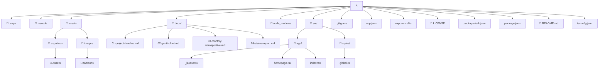

# 📌 SETU Social

> **One-line pitch:** *An application designed as an all-in-one source that promotes social events and gatherings amongst Students and members of the SETU community to promote social engagement & interaction.*

<!-- Optional badges — update the values or delete the line. -->


---

## 👤 Project Details

| Field | Detail |
|---|---|
| **Student Name** | Ciaran O' Toole |
| **Student ID** | C00297672 |
| **Supervisor** | Omer Ali |
| **Programme / Module** | BSc (Hons) in Software Development |
| **Academic Year** | 2023–2027 |
| **Meeting Schedule** | Weekly, Tuesdays 3:00 |
| **Repository** | https://github.com/phqsmophobia/SETU-Social-Application |

---

## 🎯 Project Scope

**Problem statement:** *The lack of a centralized platform for discovering social events may limit students' awareness of opportunities on and around the campus in the SETU community, negatively impacting their college experience.* 

**Aim:** *The aim of this project is to develop an application centralized around making it simple for students and SETU community members to find, interact with, and take part in social events happening around the campus.*

**Objectives**

- [1] To provide a centralised easy to use hub for all events within the SETU community to encourage and assist in student engagement in said social events.
- [2] To provide a platform that allows for external events hosted by the college, events the college knows of, clubs and societies to be posted to a singular easy to use platform.
- [3] To ensure secure authentication and secure data handling.

### ✅ In Scope
- Cross Platform Mobile Application: Developed for both iOS & Android 

- Student, Admin, Event Organizer accounts: Account heirarchy, different permission levels

- Authentication: Proper authentication system

- Location & Directions: Forward the user to the google maps/ apple maps pin or provide breif location description

- Event discovery: allow users to find social events 

- Event creation: allow admins or event organisers to post events

- Event details: provide valid event details to the user about the social gathering

- Event sharing externally: allow events to be shared to external messaging apps 

- Event management: allow admin SETU accounts manage and verify events being posted by event organiser accounts

- Web admin Panel: Admin panel for data analytics and verification, ONLY for SETU Admins 

- Trending, home & personalized tabs: Tabs to categorise social events 

- Reminder Notifications: remind users of events they are interested in or massive in the trending tab 

- Potentially cosmetic rewards: possible badges could be earnt using the app and attending events 

- Analytics & data to help visualize engagement: gather data on events to help visualise engagement

- Possible calendar sync: maybe include a way to add to device calendars

### 🚫 Out of Scope
- *Handle event registration fees: The application is for promotion of events only.* 

- *Ticket handling: Similar to fees, tickets will NOT be handled here however they can link the website for the ticket sales.* 

- *Messaging feature (can be shared externally instead)*

---

## 📝 Brief Summary

*An application designed as an all-in-one source that promotes social events and gatherings amongst Students and members of the SETU community to promote social engagement & interaction. 

 
The application will be developed as a cross-platform mobile application, allowing it to support both Android and iOS devices from a shared codebase using React Native. Throughout the project's development, version control will be utilized to monitor changes and preserve the source code. *

---

## 🛠️ Technologies Used

*List the actual stack. Delete rows that do not apply and add your own.*

| Layer | Technology | Purpose / Notes |
|---|---|---|
| **Platform** | *Android & iOS* | *Student's use multiple mobile device platforms.* |
| **Language(s)** | *TypeScript/JavaScript* | *Core implementation* |
| **Frontend** | *React Native, CSS Styling* | *User interface* |
| **Backend / API** | *Supabase* | *Application logic* |
| **Database** | *PostgreSQL, Supabase* | *User Data storage* |
| **Infrastructure / Hosting** | *Cloudflare, Expo* | *Deployment* |
| **Testing** | *---* | *Quality assurance* |
| **Tooling / DevOps** | *e.g. Git, GitHub Actions* | *CI/CD, version control* |
| **Libraries / Frameworks** | *e.g. Tailwind, Pandas* | *Key dependencies* |

---

## 🗂️ Repository Structure



<details>
<summary>📁 Plain-text fallback (if the tree above does not render)</summary>

```text
project-root/
├── src/
│   ├── app/
│       ├── _layout.tsx
│       ├── homepage.tsx
│       ├── index.tsx
│   ├── styles/
│       ├── global.ts
├── docs/
│   ├── 01-project-timeline.md
│   ├── 02-gantt-chart.md
│   ├── 03-monthly-retrospective.md
│   └── 04-status-report.md
└── README.md
```

</details>

> ℹ️ This uses a Mermaid **flowchart** (`graph TD`), which renders reliably on GitHub. Prefer it to the box above, or keep both. *(A `treeView` diagram exists only on Mermaid.ai, not in GitHub's open-source Mermaid, so it would show as raw text — avoid it.)*

---

## 📊 Project Tracking & Reports

All ongoing project management lives in [`/docs`](./docs). Update these from the tasks recorded in your **shared meeting sheet** (minutes of meetings).

| Document | What it is | Update cadence |
|---|---|---|
| 📅 [Project Timeline](./docs/01-project-timeline.md) | Phases and milestones across the whole project | At each milestone |
| 📈 [Gantt Chart](./docs/02-gantt-chart.md) | Scheduled tasks with durations and dependencies | Fortnightly |
| 🔄 [Monthly Retrospective](./docs/03-monthly-retrospective.md) | What went well / to improve / actions (Kanban) | Monthly |
| 🗒️ [Status Report](./docs/04-status-report.md) | Current work + last week's tasks (Kanban) | Weekly |

---


---

