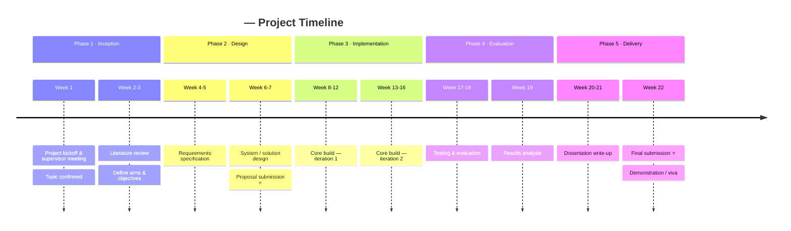

# 📅 Project Timeline

> **Purpose:** A high-level, chronological view of the whole project — the phases and the key milestones within them. Unlike the [Gantt chart](./02-gantt-chart.md) (which tracks scheduled task durations), the timeline is about *when the big moments happen*.
>
> **Update:** At the start of the project, then whenever a milestone is reached or a date shifts.

**Last updated:** *YYYY-MM-DD* · **Maintained by:** *\<Your name\>*

---

## 🧭 Timeline at a Glance

*Replace the example entries below with your own phases and events. Each `section` is a phase; each line is `Period : Event : Event`.*

> ℹ️ The `timeline` diagram is widely supported. If it does not render, the milestone table below is the authoritative record.

---

## 🏁 Milestones & Deliverables

*The checkpoints your supervisor and course will assess against. Mark status as you progress.*

| # | Milestone / Deliverable | Target Date | Status |
|---|---|---|---|
| M1 | Project proposal approved | *YYYY-MM-DD* | ☐ Not started |
| M2 | Literature review complete | *YYYY-MM-DD* | ☐ Not started |
| M3 | Requirements & design signed off | *YYYY-MM-DD* | ☐ Not started |
| M4 | Minimum viable prototype | *YYYY-MM-DD* | ☐ Not started |
| M5 | Feature-complete build | *YYYY-MM-DD* | ☐ Not started |
| M6 | Testing & evaluation complete | *YYYY-MM-DD* | ☐ Not started |
| M7 | Dissertation draft to supervisor | *YYYY-MM-DD* | ☐ Not started |
| M8 | Final submission & demo | *YYYY-MM-DD* | ☐ Not started |

**Status key:** ☐ Not started · 🟡 In progress · ✅ Done · ⚠️ At risk · ⏸️ Blocked

---

## 📌 Phase Summary

| Phase | Dates (from–to) | Key outcome | Status |
|---|---|---|---|
| 1 · Inception | *YYYY-MM-DD → YYYY-MM-DD* | *Confirmed topic & plan* | 🟡 |
| 2 · Design | *…* | *Approved design* | ☐ |
| 3 · Implementation | *…* | *Working build* | ☐ |
| 4 · Evaluation | *…* | *Validated results* | ☐ |
| 5 · Delivery | *…* | *Submitted & demoed* | ☐ |

---

## 🔁 Change Log

*Record any significant date or scope change so the history is visible.*

| Date | Change | Reason |
|---|---|---|
| *YYYY-MM-DD* | *e.g. M4 moved +1 week* | *e.g. API integration took longer than estimated* |
