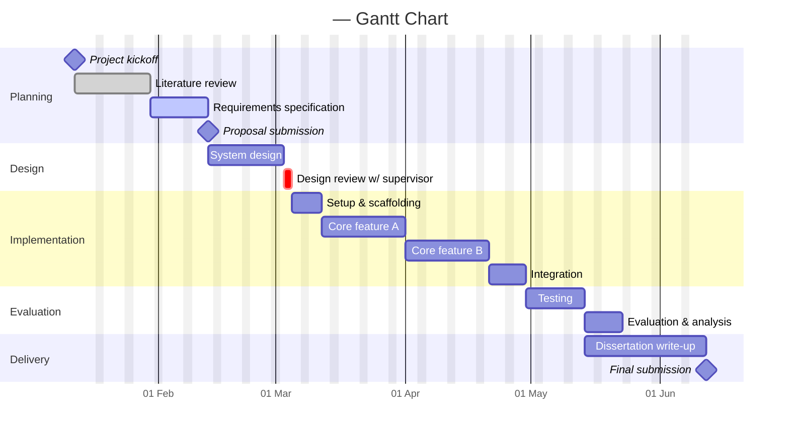

# 📈 Project Gantt Chart

> **Purpose:** A schedule of the actual *tasks* — their durations, order, and dependencies. This is where planning meets reality: set your plan, then keep it honest by marking tasks `done`/`active` and adjusting dates as things move.
>
> **Update:** Fortnightly (or whenever tasks start/finish). Pull the task list from your **shared meeting sheet**.

**Last updated:** *YYYY-MM-DD* · **Maintained by:** *\<Your name\>*

---

## 🗓️ Schedule

*Edit the sections and tasks below. Syntax reference is at the bottom of this file.*

> ℹ️ If the `todayMarker`/`excludes` lines cause issues on an older renderer, delete them — the chart will still work.

---

## 🧱 Task Register

*The same tasks in table form — useful for status at a glance and as a fallback if the chart does not render.*

| ID | Task | Section | Start | End | Duration | Depends on | Status |
|---|---|---|---|---|---|---|---|
| pl1 | Literature review | Planning | *YYYY-MM-DD* | *YYYY-MM-DD* | 14d | — | ✅ Done |
| pl2 | Requirements specification | Planning | *…* | *…* | 10d | pl1 | 🟡 Active |
| ds1 | System design | Design | *…* | *…* | 12d | pl2 | ☐ |
| im2 | Core feature A | Implementation | *…* | *…* | 14d | im1 | ☐ |
| … | *…* | *…* | *…* | *…* | *…* | *…* | ☐ |

**Status key:** ☐ Not started · 🟡 Active · ✅ Done · 🔴 Critical/at-risk

---

📘 Mermaid Gantt syntax cheat-sheet (click to expand)

- **A task:** `Task name :tag, id, start, duration` — e.g. `Core feature A :active, im2, 2026-03-01, 14d`
- **Tags:** `done` (completed), `active` (in progress), `crit` (critical), `milestone` (zero-length marker). Combine with commas: `:crit, active, id, ...`
- **Dependencies:** use `after <id>` instead of a start date — e.g. `:im3, after im2, 14d`
- **Durations:** `d` days, `w` weeks, `h` hours.
- **Milestone:** `Proposal :milestone, m2, 2026-02-10, 0d`
- **Dates:** controlled by `dateFormat YYYY-MM-DD`; display format by `axisFormat`.
- **If the chart renders blank:** make sure it doesn't *end* on a `milestone` line — a zero-width last item can break the layout. Add a short normal task after it, or remove `excludes weekends`.

Full docs: <https://mermaid.js.org/syntax/gantt.html>

