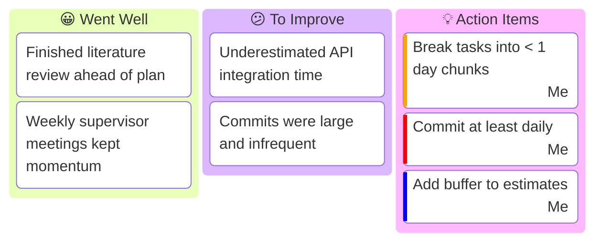
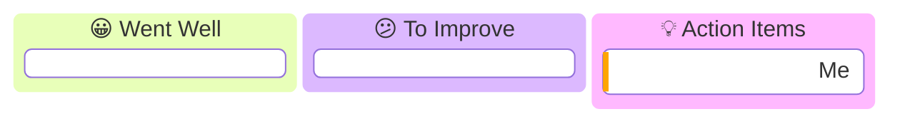

# 🔄 Monthly Retrospective

> **Purpose:** Once a month, step back and reflect: what worked, what didn't, and what you will change. This is where you turn experience into action. Keep every month's retro below (newest at the top) so the growth is visible across the project.
>
> **Update:** Monthly. Base it on the month's meeting notes and your weekly [status reports](./04-status-report.md).

**Maintained by:** *\<Your name\>*

---

## 🗂️ How to use this file

Copy the **"Retrospective Template"** block at the bottom for each new month and paste it directly under this line, so the most recent month is always first.

---

## 📅 Retrospective — \<Month YYYY\>

**Period covered:** *YYYY-MM-DD → YYYY-MM-DD* · **Milestones hit this month:** *M2, M3*

### Board



> ℹ️ `kanban` is a newer Mermaid diagram. If it renders as raw text on GitHub, the table below carries the same information — keep both.

### Summary (table fallback)

| 😀 Went Well | 😕 To Improve | 💡 Action Items (owner · priority) |
|---|---|---|
| *Finished lit review early* | *Under-estimated integration* | *Smaller task chunks · Me · High* |
| *Meetings kept momentum* | *Large, rare commits* | *Commit daily · Me · Very High* |

### Reflection

- **Biggest win:** *…*
- **Biggest challenge:** *…*
- **What I learned:** *…*
- **Carry-over to next month:** *…*

### Metrics *(optional)*

| Metric | This month | Target |
|---|---|---|
| Milestones completed | *2 / 2* | *…* |
| Commits | *…* | *…* |
| Hours logged | *…* | *…* |

---

<details>
<summary>📋 Retrospective Template (copy this for a new month)</summary>

> The outer block below uses `~~~` fences so you can see the inner ` ``` ` mermaid fences. When you paste, keep the mermaid block's three backticks and drop the `~~~` lines.

~~~markdown
## 📅 Retrospective — <Month YYYY>

**Period covered:** YYYY-MM-DD → YYYY-MM-DD · **Milestones hit this month:** <…>

### Board



### Summary (table fallback)

| 😀 Went Well | 😕 To Improve | 💡 Action Items (owner · priority) |
|---|---|---|
|  |  |  |

### Reflection

- **Biggest win:**
- **Biggest challenge:**
- **What I learned:**
- **Carry-over to next month:**
~~~

</details>
