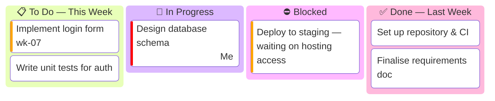
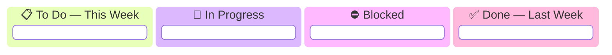

# 🗒️ Project Status Report

> **Purpose:** Your living, week-by-week record of progress. It answers three questions your supervisor asks every meeting: *What did you do? What are you doing now? What is blocking you?* The tasks come from your **shared meeting sheet** (minutes of meetings) — copy them here and track them to completion.
>
> **Update:** Weekly (or fortnightly), before each supervisor meeting. Keep the newest report at the top.

**Maintained by:** *\<Your name\>*

---

## 🗂️ How to use this file

1. Each meeting cycle, copy the **"Status Report Template"** at the bottom and paste it directly under this line (newest first).
2. Move cards across the Kanban board to reflect reality.
3. Make sure every task from the meeting sheet appears somewhere on the board.

---

## 📆 Status Report — Week of \<YYYY-MM-DD\>

**Reporting period:** *YYYY-MM-DD → YYYY-MM-DD* · **Next meeting:** *YYYY-MM-DD* · **Overall health:** 🟢 On track

### Progress Board



> ℹ️ `kanban` is a newer Mermaid diagram. If GitHub shows it as raw text, use the tables below — they carry the same information.

### ✅ Completed since last meeting

| Task (from meeting sheet) | Outcome / Evidence (commit, PR, doc) |
|---|---|
| *Set up repository & CI* | *link / commit hash* |
| *Finalise requirements doc* | *link* |

### 🔨 In progress / planned for next cycle

| Task | Target date | Notes |
|---|---|---|
| *Design database schema* | *YYYY-MM-DD* | *…* |
| *Implement login form* | *YYYY-MM-DD* | *…* |

### ⛔ Blockers & risks

| Blocker / Risk | Impact | What I need |
|---|---|---|
| *Waiting on hosting access* | *Can't deploy to staging* | *Supervisor to confirm credentials* |

### ❓ Questions for supervisor

- *…*

### 📝 Notes from this week's meeting

- *Key decisions / advice captured here, then transferred into tasks above.*

---

<details>
<summary>📋 Status Report Template (copy this each cycle)</summary>

> The outer block uses `~~~` fences so you can see the inner ` ``` ` mermaid fence. When you paste, keep the mermaid block's three backticks and drop the `~~~` lines.

~~~markdown
## 📆 Status Report — Week of <YYYY-MM-DD>

**Reporting period:** YYYY-MM-DD → YYYY-MM-DD · **Next meeting:** YYYY-MM-DD · **Overall health:** 🟢 On track / 🟡 Minor issues / 🔴 At risk

### Progress Board



### ✅ Completed since last meeting

| Task (from meeting sheet) | Outcome / Evidence |
|---|---|
|  |  |

### 🔨 In progress / planned for next cycle

| Task | Target date | Notes |
|---|---|---|
|  |  |  |

### ⛔ Blockers & risks

| Blocker / Risk | Impact | What I need |
|---|---|---|
|  |  |  |

### ❓ Questions for supervisor

-

### 📝 Notes from this week's meeting

-
~~~

</details>
